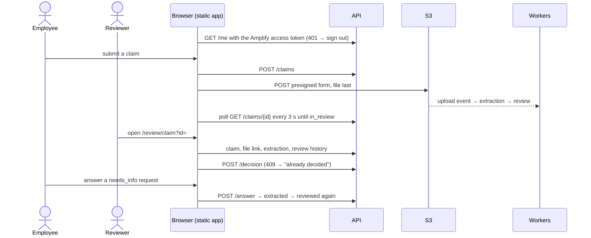

# T13 — Frontend

**Goal:** the flow can be used and demonstrated without an API client. **Out of scope:** admin
pages, dashboards, editing `corrected_fields` in the UI, hosting (the frontend runs locally like the
API; S3 + CloudFront later), a new document in answer to `needs_info` (T12).

## Acceptance criteria

| Criterion | How | Tested by |
|---|---|---|
| Login through Cognito; pages limited by role | Amplify's `<Authenticator>` until signed in; the role comes only from `GET /me`. One page → roles map drives the nav and `PageGate`, which sends a page the role may not open to `/`; `/` sends employees to `/claims`, reviewers to `/review`, admins to a "coming soon" notice. Unknown URLs get a 404 page; sign-out clears the query cache. Navigation only: the API enforces every rule | `AuthGate.test.tsx`, `PageGate.test.tsx`, `HomeRedirect.test.tsx`, `NotFoundNotice.test.tsx`, `AppShell.test.tsx` |
| Employee: create a claim and upload its file; list of own claims with status (a reviewer's list shows every claim) | `/claims/new` checks the fields as T04 does, `POST /claims`, then posts the presigned form to S3 (fields first, file last). `/claims` lists what `GET /claims` returns, 20 per page. `/claims/view?id=` polls until a person is needed and shows the file, the failure reason, the reviewer's comments and, for the owner of a `needs_info` claim, the answer form (`POST /answer`) | `NewClaimForm.test.tsx`, `ClaimList.test.tsx`, `ClaimDetail.test.tsx`, `AnswerForm.test.tsx`, `ReviewerComments.test.tsx` |
| Reviewer: claims in review; one page with the document, its extracted fields and warnings, and the proposal with its quoted clauses; approve, reject or request information with a comment | `/review` lists `in_review` claims. `/review/claim?id=` shows the document (PDF in an iframe, image as an image), the extraction (new `GET /claims/{id}/extraction`, warnings highlighted) and the newest proposal with its quoted clauses (earlier rounds collapsed), each panel with its own query. The decision form is preset to the proposal; a comment is required for reject, needs_info or a different decision, as in the API. A decided claim (also after a 409) shows a notice instead; no form on the reviewer's own claim | `ReviewQueue.test.tsx`, `ReviewClaim.test.tsx`, `ProposalPanel.test.tsx`, `DecisionForm.test.tsx`, `tests/extraction/test_extraction_api.py`, `test_extraction_api_db.py`, `tests/review/test_decisions_db.py` |
| Loading and error states on every async view | Every query renders through `<QueryState>`: a spinner, then the data or an error with "Try again"; a 4xx shows the API's `detail` (the first message of a validation 422), a 5xx or network failure a generic message. A 401 signs out. Mutations disable their button and show errors inline | `QueryState.test.tsx`, `client.test.ts`; a loading and a 500 case in each async view's test |
| A change in an API response shape is caught by the build or tests, not by a user | Types are generated from the committed `frontend/openapi.json`; MSW handlers are typed by the same schema, so an outdated fixture fails `tsc` | `tests/test_openapi_snapshot.py`; CI `frontend` job (`gen:api` + `git diff --exit-code`, `tsc`, `next build`) |

## Flow

## Design decisions

- **Static export SPA:** every page is a client component fetching with the user's token, so only
  static files run; detail pages use `?id=` (no `generateStaticParams` for claim ids) and the CSP is
  a `<meta>` tag ([static exports](https://nextjs.org/docs/app/guides/static-exports)). *Rejected:*
  `next start` (a Node process for prettier URLs), a Next BFF with tokens in an httpOnly cookie (a
  second backend; an injected script can still call it).
- **Amplify `<Authenticator>`:** SRP keeps the password in the browser, and sign-up with the email
  code and forgot password come with it, with no Terraform change
  ([auth flows](https://docs.aws.amazon.com/cognito/latest/developerguide/amazon-cognito-user-pools-authentication-flow-methods.html)).
  *Rejected:* our own forms on `aws-amplify/auth` (every Cognito challenge ours), Hosted UI + PKCE
  (a Cognito domain and callbacks in Terraform, login leaves the app).
- **Types from a committed `openapi.json`:** `make openapi` writes the schema (only once it is
  built) and generates `schema.d.ts`; one `openapi-fetch` client types every call; money stays a
  string. A shape change fails the snapshot test, then CI's diff, then `tsc`. *Rejected:* runtime
  zod from a generator (heavier, and API and frontend ship from one repo), hand-written types.
- **`GET /claims/{id}/extraction` for the owner and reviewers,** scoped through `get_claim`, so
  another employee's claim is the same 404 as a missing one. *Rejected:* reviewers only (owners
  couldn't see what was read from their receipt), embedding it in `ClaimRead` (every list query
  would load extractions).
- **Employee detail page with the `needs_info` answer,** so the whole loop needs no curl.
  *Rejected:* a read-only detail page, the list alone.
- **By feature, thin routes:** a route renders one feature component; access is checked once, by
  `PageGate`. *Rejected:* by type (a feature's pieces end up scattered).
- **A comment is required to reject (changes T12's rule):** employees never see the proposal, so a
  rejection that agreed with it reached them without a reason.
- **Server state in TanStack Query:** a claim is polled every 3 s while `pending_upload` to
  `extracted`; lists refetch on focus (which also picks up a role change, T03 gap). A file link's
  freshness follows its `expires_at`: the employee's link is replaced 30 s early, the reviewer's
  viewer is never reloaded under the reader ("Reload document" fetches a new one).
- **CORS for `FRONTEND_ORIGINS`:** `GET`/`POST`, `Authorization` and `Content-Type`, no
  credentials (the token is a header). The bucket's CORS lists the same origins (T04).
- **shadcn/ui on Tailwind:** accessible Radix components, kept as generated code; Amplify's UI is
  themed through its CSS variables. *Rejected:* Mantine (a second styling system, larger bundle),
  MUI (heaviest, runtime styles), Tailwind only (focus, radio groups and collapsibles left to us).
- **Plain stack:** npm, Vitest + React Testing Library + MSW with Amplify mocked; ESLint
  `next/core-web-vitals` with `react/no-danger` as an error.

## Questions

- **Where does the browser keep tokens?** In `localStorage`, Amplify's default
  ([tokens](https://docs.amplify.aws/react/build-a-backend/auth/concepts/tokens-and-credentials/)):
  access and ID tokens (15 min) and the refresh token, now 8 hours instead of 30 days, so a
  forgotten session ends within a working day. Sign-out revokes the refresh token and clears
  storage. *Rejected:* `sessionStorage` (a copied token stays valid; a login per tab), in memory (a
  login per reload, and `fetchAuthSession()` still hands the tokens to any script).
- **What could a script injected into the page do with them?** Everything the user can: call the
  API as them (for a reviewer, every claim, file and decision), mint access tokens with the refresh
  token for up to 8 hours, and use an access token it holds for 15 minutes after sign-out (offline
  checks, T03). No storage choice prevents this, so scripts are kept out: React escapes all text,
  no `dangerouslySetInnerHTML` (a lint error), no markdown or third-party scripts; a `<meta>` CSP
  limits scripts to `'self'` and connections, images and frames to the API, Cognito and the bucket,
  with `object-src 'none'`. Limits: `'unsafe-inline'` (the export's inline hydration scripts; nonces
  need a server, [CSP](https://nextjs.org/docs/app/guides/content-security-policy)), a top-level
  navigation can still leak a token, and `frame-ancestors` is ignored in `<meta>`.

## Configuration

- **API:** `FRONTEND_ORIGINS` (`list[str]`, default `[]`) in `.env.example` and the compose `api`.
- **Frontend:** `frontend/.env.example` with `NEXT_PUBLIC_API_URL`, `NEXT_PUBLIC_COGNITO_REGION`,
  `NEXT_PUBLIC_COGNITO_USER_POOL_ID`, `NEXT_PUBLIC_COGNITO_APP_CLIENT_ID`,
  `NEXT_PUBLIC_DOCUMENTS_ORIGIN` (the bucket's URL, for the CSP): public values baked in at build;
  the build fails if one is missing.
- **Terraform `modules/cognito`:** refresh token 8 hours.
- **Make / CI:** `make openapi`; CI job `frontend` (lint, `tsc`, Vitest, the `gen:api` diff, the
  build with `.env.example`). README: "Run the frontend".

## Known gaps

- `'unsafe-inline'` in `script-src` and no `frame-ancestors` until hosting sets response headers.
- An access token stolen before sign-out still works for up to 15 minutes (offline verification).
- A failed S3 upload (or a closed browser) leaves the claim `pending_upload` (T04); submitting
  again creates a new claim, and the orphan's page keeps polling while open.

## Testing

- **Unit:** frontend components, hooks, CSP and API client (Vitest + RTL + MSW, no AWS); the API's
  extraction route (401, admin 403, OpenAPI), CORS and the OpenAPI snapshot.
- **Integration:** the extraction endpoint (owner and reviewer 200; another employee and a random
  id the same 404; not yet extracted → 404); reject without a comment → 422.
- **Manual:** `make up`, the workers, `npm run dev`: sign up, submit a PDF, reach `in_review`;
  needs_info with a comment, the employee answers, approve; the admin notice, the redirect from a
  page the role may not open, the 404 page; `npx serve out` with no CSP errors.

## Results

2026-11-19: the manual run passed end to end, including the static build.  `/code-review` run,
findings fixed (left out: retrying only the upload, the
duplicated `_errors` helper, fail-closed page access).
