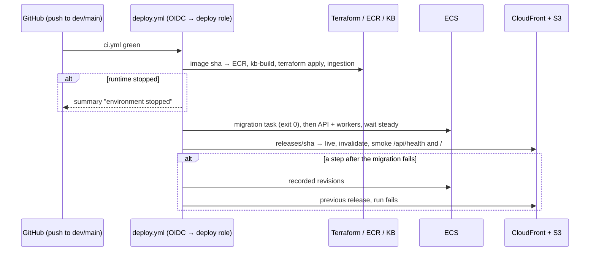

# T14 — Deployment and CI/CD

**Goal:** a merge to main reaches AWS without manual steps. **Out of scope:** deploying the MCP server
(T10), a custom domain, separate AWS accounts per environment, Multi-AZ, automatic secret rotation.

## Acceptance criteria

| Criterion | How | Tested by |
|---|---|---|
| A merge to main builds, deploys and runs a smoke request without manual steps | `deploy.yml` on push to `main` (→ prod) / `dev` (→ dev): CI, image, `terraform apply`, KB ingestion, migration, ECS deploy, frontend release, smoke through CloudFront; any failure after the migration rolls back. A stopped environment gets the base and image only | `tests/test_workflows.py`, `tests/test_pipeline_scripts.py` |
| Pull requests run lint, type check, tests with coverage ≥ 80%, evals against fakes, frontend lint and type check | `ci.yml` on `pull_request` + `workflow_call`: `lint`, `typecheck`, `test`, `evals`, `frontend`, `actionlint`, `terraform` (fmt + validate) | `tests/test_workflows.py` |
| GitHub holds no long-lived AWS keys | OIDC → `<project>-<env>-deploy`, trusted per repository + environment, 1-hour sessions | `tests/test_workflows.py` |
| Infrastructure changes deploy through the pipeline, not from a laptop | The state bucket policy lets only each deploy role write its state and lock; Start/Stop are workflows; `bootstrap` is the one admin root | `tests/test_workflows.py` |
| docs/pipeline.md describes every pipeline step and why | One entry per job/step (what, why, what failing means); bootstrap, start/stop, database and rollback runbooks | `tests/test_workflows.py` |
| An alarm fires on failed claims; Bedrock tokens per claim are a metric | EMF lines from the workers: `ClaimsFailed{Stage}` → alarm → SNS email; `BedrockInput/OutputTokens{Stage}` on the dashboard; DLQ alarms | `tests/core/test_metrics.py`, `tests/extraction/test_worker_db.py`, `tests/review/test_review_db.py` |

## Flow

## Design decisions

- **Two environments, `dev` → `environments/dev`, `main` → `environments/prod`:** separate roots and state keys, same modules, a GitHub environment each. *Rejected:* one environment from main (nowhere to try a change).
- **Stopped when idle, `runtime_enabled` toggles what bills by the hour** (NAT + EIP, RDS, ALB, VPC origin and `/api/*`, ECS services, alarms); Cognito, buckets, SQS, Lambdas, SES, KBs, ECR, IAM and the distribution stay, so users, emails and the URL survive. Stop takes the final snapshot `<project>-latest` (the previous one deleted first, only while the DB exists), Start restores it (`restore_db_snapshot` from a lookup in the scripts; `snapshot_identifier` ignored after create). Start/Stop write SSM `/<project>/runtime_enabled` and dispatch the deploy, in their own queue so a push can't cancel a waiting Stop. About $1–3/month idle, 10–15 min to start. *Rejected:* full destroy (new pool, URL, SES and KB, data lost), scale to zero (ALB + NAT ≈ $55/month, RDS auto-starts after 7 days).
- **Private subnets, one NAT, S3 gateway endpoint:** tasks, ALB and RDS have no public address; Bedrock, SQS, Cognito/JWKS, ECR, Logs and Secrets Manager go through the NAT, S3 through the free endpoint. API admits only the ALB, RDS only the tasks. *Rejected:* public task IPs (internet-addressable, IPv4 charges), interface endpoints only (≈ $0.19/h, JWKS may still need a NAT), NAT instance (patching).
- **One CloudFront distribution, the only entry point:** S3 site with OAC; a function maps routes from the `page.tsx` files and serves `404.html` for other paths (custom error responses would replace the API's 403/404); `/api/*` → the API with the prefix stripped. One HTTPS origin: no CORS for the API, `connect-src 'self'`. A headers policy adds `frame-ancestors 'none'`, HSTS, `nosniff` (T13's header gap). *Rejected:* two distributions (CORS, second CSP origin), ALB + ACM (no domain), Amplify Hosting (builds outside the pipeline).
- **API origin: VPC origin to an internal ALB** that admits only CloudFront's service-managed security group ([VPC origins](https://docs.aws.amazon.com/AmazonCloudFront/latest/DeveloperGuide/private-content-vpc-origins.html)); `create_before_destroy` so Stop drops it from the distribution before deleting it. *Rejected:* public ALB + secret header (tokens and receipts in cleartext between edge and origin).
- **Terraform for infrastructure, `update-service` for the app:** images tagged with the SHA (immutable); services created with 0 tasks and `ignore_changes = [task_definition, desired_count]`. The deploy applies (registering task definitions with `image_tag`), runs the migration task, points the services at the new revision with 1 task, waits stable and checks the revision stayed. *Rejected:* the ECS render/deploy actions (a second identical revision), Terraform deploying the image (migration between two applies, rollback drifts state), blue/green (workers have no traffic).
- **Rollback: circuit breaker, then auto-rollback after any failure past the migration:** the job records running revisions and `live/release.txt` before the apply; on failure it redeploys them and republishes that release (copy every object, then `sync --delete`, since a sync skips same-size files). Migrations stay backward-compatible; schema is never rolled back; `git revert` is the permanent fix. *Rejected:* circuit breaker only (a failed smoke leaves it broken), blue/green with bake time.
- **Deploy role capped by a permissions boundary, trust anchor in `bootstrap`** (OIDC provider, roles, boundaries; admin-applied once, since it is what lets the pipeline in). App roles and policies move under `/<project>-<env>/`; the first dev deploy does the move, so the role may also delete the old root-path ones. *Rejected:* an admin moving them with `-target`, `AdministratorAccess` (rewrites its own policy), `PowerUserAccess` + IAM (escalation).
- **DB password write-only, never in state:** an ephemeral random value written once to a secret (`secret_string_wo`, new on `db_password_version`); RDS reads the secret ephemerally into `password_wo`, so every Start and restore matches; ECS injects `PGPASSWORD`. *Rejected:* one random value to both in one apply (RDS is created later), RDS-managed password (rotation, deleted on stop, can't be set on restore), `random_password` (in state).
- **Metrics as EMF log lines** ([EMF](https://docs.aws.amazon.com/AmazonCloudWatch/latest/monitoring/CloudWatch_Embedded_Metric_Format_Specification.html)): namespace `Larkfield/<env>`, dimension `Stage`, `claim_id` a property. `ClaimsFailed` next to every `notify_claim_failed`; token metrics once per claim per stage, also for a run that raises after spending (`BedrockRunError`). Written with `asyncio.to_thread`. *Rejected:* `PutMetricData` (IAM, a failing call per claim), metric filters (break on rewording).
- **Alarms by email:** SNS per environment; `ClaimsFailed` ≥ 1 in 5 min and any DLQ message (T12's gap), missing data OK, only while running. *Rejected:* failed claims only, no target.
- **CI reused by the deploy:** the merge commit is tested before it ships; `evals` is its own check, `test` still covers everything at 80 %.
- **Laptop applies blocked:** only the deploy role writes `<env>/` state and lock; local `plan` still works.
- **Policy KB synced by the pipeline:** `make kb-build` before the apply, then an incremental ingestion job on the clause data source. Prod creates only the clause KB.
- **Smoke request through CloudFront:** `/api/health` with `database: ok` and `/`, retried up to 3 min; workers prove themselves by steady state.
- **Database access through the api task:** ECS Exec + Session Manager port forwarding to RDS for any client (DBeaver, psql); IAM-gated, in CloudTrail, only while started. *Rejected:* public RDS limited to one IP, a jump instance, Client VPN (cost).

## Questions

- **What can the deploy role do?** Assumed only via OIDC with `sub = repo:DmitriyDomnich@30810623/Larkfield@1430908221:environment:<env>` (immutable subject with owner and repository ids); the environment's branch rule limits `prod` to `main`, `dev` to `dev` ([GitHub OIDC](https://docs.github.com/en/actions/security-for-github-actions/security-hardening-your-deployments/configuring-openid-connect-in-amazon-web-services)). It manages the services Terraform uses on `<project>-<env>-*` resources, its own state key only, and IAM only under `/<project>-<env>/` with the boundary attached, passable to `ecs-tasks`, `lambda`, `bedrock`.
- **Could it grant itself more?** No: its role, the boundary, the OIDC provider and `bootstrap/` state are explicit denies, no users or keys, and every role it makes is capped by a boundary that denies IAM ([boundaries](https://docs.aws.amazon.com/IAM/latest/UserGuide/access_policies_boundaries.html)). Within its environment it can do anything the app can, plus delete it, so branch protection is part of the control. Dev can't touch prod: name prefixes, separate state, and a deny on resources tagged with another `Environment`. Pipeline roles live under `/<project>-bootstrap/`.

## Configuration

- **`bootstrap`** (admin, once): OIDC provider, per environment the deploy role and boundary, the imported state bucket and its policy. Variables `github_subject_prefix`, `environments`, `state_bucket`.
- **`environments/prod`:** like dev, clause KB only, Cognito without password auth and with deletion protection, `manage_email_identities = false`: dev owns the account-level SES identities. *Rejected:* identities in `bootstrap` (admin apply per recipient), separate addresses (verify twice).
- **Modules:** `network`, `database` (PostgreSQL 17 `db.t4g.micro`, 20 GB, single-AZ), `runtime` (ECR, cluster, API 0.5 vCPU / 1 GB, extraction 0.25 / 0.5, review 0.5 / 1, migration task, internal ALB, ECS Exec on the api), `frontend`, `monitoring`. Terraform `>= 1.11`, AWS provider `~> 6.0`.
- **Naming:** prefix `larkfield-<env>` (today's dev `project_name`, nothing renamed); new variables `environment`, `runtime_enabled`, `restore_db_snapshot`, `db_password_version`, `image_tag`, `alarm_email`, `extra_frontend_origins`. No new `Settings` fields.
- **GitHub:** environments `dev`, `prod` with `AWS_ROLE_ARN` and `TFVARS`; repo `AWS_REGION`, `TF_STATE_BUCKET`; no secrets. The repository is public, so the deploy masks every email in `TFVARS`.
- **Code:** `app/core/metrics.py`, `docs/pipeline.md`, `infra/scripts/` (`terraform-vars.sh`, `push-image.sh`, `publish-release.sh`), `pyyaml` (dev).

## Known gaps

- `bootstrap` is applied by an admin from a laptop; the deploy role may delete the pre-T14 root-path roles.
- Dev and prod share one account; a boundary mistake affects both.
- Whoever can merge to `main` holds the prod deploy role's power; admins can bypass branch protection.
- Rollback restores code, not schema.
- CloudFront → ALB is HTTP inside AWS; end-to-end TLS needs a domain.
- `'unsafe-inline'` stays in `script-src` (T13); a missing page is `404.html` with status 200.
- Prod's email depends on the SES identities in dev's state.
- Single-AZ RDS, one NAT, one task per service: an AZ outage or task restart is downtime.
- Start takes 10–15 min; snapshots bill for storage; messages wait in SQS while stopped (4 days, DLQs 14).
- No password rotation (bump `db_password_version` and redeploy).
- An ECS Exec session on the api reaches the database; only admin IAM users have it.

## Testing

- **Unit:** the EMF line, worker metrics on every failure path and per claim, the workflows (triggers, jobs, OIDC only, docs coverage, deploy order), the pipeline scripts against a fake `aws`.
- **Integration:** worker DB tests with the metric assertions.
- **Manual:** bootstrap and GitHub setup; base deploy, Start, smoke; a commit failing `/health` (circuit breaker); a broken smoke request (revisions and frontend restored); failed claim → alarm email, tokens on the dashboard; local apply fails on the lock; database tunnel; Stop, Start, data kept.

## Results

2026-11-24, on `dev`, deployed from a temporary branch mapped to the `dev` environment before the
merge. The first deploy applied the base with the environment stopped; Start created the NAT, RDS,
ALB, VPC origin and services, ran the migration and passed the smoke request through CloudFront.
D01 went through extraction, review, the reviewer's decision and the email; E10 ended `failed`, the
`ClaimsFailed` alarm sent its email, and both stages' tokens showed on the dashboard. The database
tunnel worked with DBeaver. Stop took the final snapshot and removed the runtime (the first one
needed the VPC origin detached by hand, as it predated the stop-order fix); Start restored the
snapshot with the claims intact; a second Stop updated the distribution before deleting the VPC
origin. These runs brought the immutable OIDC subject, the first-deploy fixes and the stop order.
A local `terraform apply` on `dev` fails acquiring the state lock. `/code-review` run, seven
findings fixed. Not run: a commit failing `/health` (circuit breaker) and a broken smoke request.
