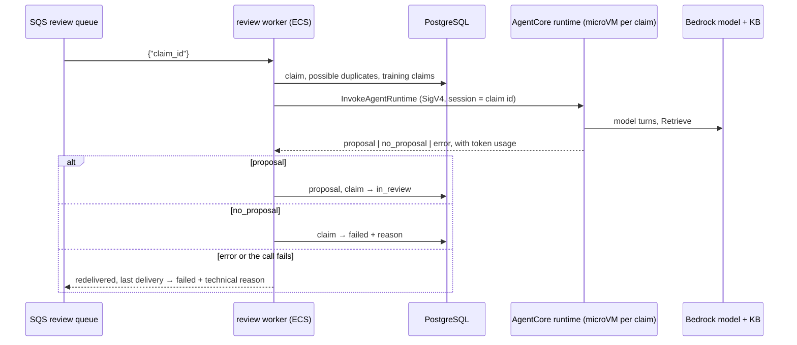

# T16 — Agent on Bedrock AgentCore Runtime

**Goal:** the agent runs on a managed agent runtime, deployed and scaled separately from the worker.
**Out of scope:** AgentCore Memory, Gateway, Identity and Observability traces; reviewing several
claims at once in one worker, or autoscaling the worker (T09 "Scaling" steps 1 and 3).

## Acceptance criteria

| Criterion | How | Tested by | Browser |
|---|---|---|---|
| The worker invokes the agent on Bedrock AgentCore Runtime; claims still end `in_review` or `failed` with a reason | With `REVIEW_AGENT_RUNTIME_ARN` set, `AgentCoreClient` sends the claim and its prefetched history to `InvokeAgentRuntime` (SigV4, session = claim id); `agentcore/server.py` runs `StrandsReviewAgent` and answers `proposal` / `no_proposal` / `error`; `review_claim` is unchanged | `tests/review/agentcore/test_client.py`, `test_server.py`, `test_contract.py`, `tests/review/test_worker.py`, `test_review_db.py` | No |
| The review evaluation gives the same decisions as before, within the run-to-run variation measured | `make eval-review args="--agentcore"` on the 24 dev cases: every case except E02 matches `review-2026-11-13-1307` (directly or in a recheck), D14 / D16 rejected | `tests/evals/test_review_run.py`, `test_review_agentcore_run.py`, `test_review_recorded_run.py` | No |
| The AgentCore runtime is defined as code and deployed by the pipeline | Terraform `modules/agent_runtime`; one arm64 build tagged `<sha>` and `<sha>-agent-runtime`; the apply moves the AgentCore runtime to the new image, the rollback re-points it | `tests/test_workflows.py`, `tests/test_pipeline_scripts.py` | No |

## Flow

## Design decisions

- **The worker prefetches the claim history and sends it with the request;** a `PrefetchedHistory` answers the tools in the AgentCore runtime, which holds no database credentials and runs in `PUBLIC` mode, so an injected agent sees only this claim's matches. The only extra query is the training one. *Rejected:* the AgentCore runtime reads PostgreSQL (VPC mode, DB secret on its role, Bedrock through the NAT, fails while stopped); the training query only for `training` claims (a book extracted as `other` loses the 5.1 yearly total).
- **Worker → AgentCore runtime: SigV4 with the worker's task role,** allowed only `InvokeAgentRuntime` on the runtime and its endpoints; no secret, every call in CloudTrail. *Rejected:* JWT from a Cognito client-credentials client (a secret to rotate, token refresh, no boto3 support; built for end users).
- **One arm64 build:** AgentCore takes only an ARM64 image URI, no command. The deploy runs on `ubuntu-24.04-arm`, the Dockerfile target `agent-runtime` is pushed as `<sha>-agent-runtime`, ECS tasks move to ARM64 (Graviton, ~20 % cheaper). *Rejected:* x86 app + separate arm64 build (two architectures); multi-arch through QEMU (several times slower).
- **Platform V1, one session per claim, idle timeout 60 s:** `runtimeSessionId` = claim id, so each claim gets a fresh microVM and a redelivery reaches the same one; the agent is stateless. *Rejected:* V2 snapshot start (restored random state repeats in every session, OpenSSL included, and our Debian OpenSSL isn't snapshot-safe; higher rates, a snapshot per deploy); the default 15 min idle timeout (idle memory billed per claim).
- **`REVIEW_AGENT_RUNTIME_ARN` picks the agent:** set → `AgentCoreClient`, empty → in-process `StrandsReviewAgent` (local stack, tests); both are a `ReviewAgent`. Terraform always sets it on the deployed worker. *Rejected:* AgentCore only (local claims would go to dev); a local AgentCore runtime container (a second client to maintain).
- **Contract (`app/review/agentcore/contract.py`):** request `{claim, possible_duplicates, training_claims}`; response discriminated on `outcome`: `proposal` (with retrieved clauses, model), `no_proposal` (detail) or `error`, each with token usage, always HTTP 200. The quote check runs in the AgentCore runtime, where the clauses are.
- **AgentCore runtime server (`agentcore/server.py`):** FastAPI `GET /ping` and `POST /invocations` on port 8080, one agent per request, model and KB clients created at startup; `ReviewRuntimeSettings` (no database, Cognito or queues). *Rejected:* the `bedrock-agentcore` SDK app (a dependency for two routes).
- **Client (`agentcore/client.py`):** the call runs in `asyncio.to_thread`, `read_timeout` 900 s (the 15 min synchronous limit), one attempt (SQS retries); any call or parse failure becomes `BedrockRunError`, so `review_claim` retries and fails claims as before.
- **AC2 by one dev run with rechecks:** `--agentcore` (the flag, not the variable, picks AgentCore) records `agent_placement`, never the ARN (public repository). A differing case gets 2 more AgentCore runs (`--ids`, with `process_after` cases) and 2 in-process, and fails only if it differs through AgentCore and not in-process. *Rejected:* dev + holdout (the holdout judges prompt changes); three full runs (3× the cost).
- **The AgentCore runtime is part of the release:** the apply sets `<sha>-agent-runtime` (a new version that `DEFAULT` follows). "record the live release" saves its configuration; on any failure after that, the migration included, `rollback-agent-runtime.sh` sends it back with `update-agent-runtime` and waits until that version is `READY`. A contract change accepts the previous request for one release. *Rejected:* no AgentCore rollback (agent and worker from different releases); an endpoint per release (cleanup, 10 per runtime, most pipeline work).

## Questions

- **What does the AgentCore runtime give, and what does it cost per claim?** The agent is deployed and versioned on its own (immutable versions, `DEFAULT` endpoint), each claim gets its own microVM (2,500 active sessions, 25 new/s per account by default, [quotas](https://docs.aws.amazon.com/bedrock-agentcore/latest/devguide/bedrock-agentcore-limits.html)), and the memory is wiped after the claim; its role reaches only the model and the KB. No throughput gain yet: the worker still reviews one claim at a time. Billing: CPU only while active, memory until the idle timeout ends the session, at $0.0895 per vCPU-hour and $0.00945 per GB-hour ([pricing](https://aws.amazon.com/bedrock/agentcore/pricing/)); measured ≈ $0.0007 per claim (Results).
- **How long does a new session take, and does it matter?** Every claim is a new session; measured about 1 s next to ~10 s of model turns. Reviews are asynchronous through SQS, so it doesn't.

## Configuration

- **Settings:** worker `REVIEW_AGENT_RUNTIME_ARN` (empty in `.env.example`). The AgentCore runtime reads `REVIEW_MODEL_ID`, `POLICY_KB_ID`, `AWS_REGION`, `REVIEW_MAX_TURNS`, `REVIEW_MAX_PROPOSAL_ATTEMPTS`, `LOG_LEVEL` from Terraform `environment_variables`.
- **Terraform:** `modules/agent_runtime` (runtime `<project>_review`, role trusted with `aws:SourceAccount` / `aws:SourceArn`, allowed ECR pull, logs, the inference profile and the clause KB, no `logs:CreateLogGroup`; log group 14 days); the review worker's policy swaps `InvokeModel` / `Retrieve` for `InvokeAgentRuntime`; ECS tasks ARM64 with `skip_destroy` on task definitions (replaced revisions stay ACTIVE for the rollback).
- **Bootstrap:** the deploy role gets `bedrock-agentcore:*`, PassRole to `bedrock-agentcore.amazonaws.com`, the `runtime-identity.bedrock-agentcore` service-linked role and the runtime log groups; the boundary gets `InvokeAgentRuntime` and `logs:DescribeLogGroups` / `DescribeLogStreams`.
- **Pipeline:** arm runner; `push-image.sh` pushes both targets; a new environment gets its ECR repository from a targeted apply and its images before the full apply; "roll back the AgentCore runtime" runs before "roll back". `docs/pipeline.md` updated.

## Known gaps

- Throughput is unchanged: one claim at a time per worker task, one task (T09 "Scaling").
- The agent's limits (12 turns × 120 s) can pass the 15 min call limit (counts as a delivery) and the 300 s visibility timeout (redelivered while running, to the same microVM; the row lock keeps one proposal).
- After a rollback, Terraform state shows the new image until the next apply. A contract change must stay compatible for one release.
- The smoke request doesn't call the agent: a broken agent shows up as `failed` claims and the `ClaimsFailed` alarm.
- The pricing page's rates aren't labelled by region.
- The review worker keeps 0.5 vCPU / 1 GB although the agent no longer runs in it.
- AgentCore Observability traces aren't enabled: logs and the T14 token metrics only.

## Testing

- **Unit:** contract (incl. a saved request), `AgentCoreClient` with a botocore `Stubber`, the AgentCore server with a scripted model, agent choice, eval `--agentcore` / `--ids` and the committed run, workflows and the rollback script against a fake `aws`.
- **Integration:** `test_review_db.py` drives the worker through a stubbed AgentCore runtime: proposal, no_proposal and last-delivery error.
- **Manual:** admin applies `bootstrap`; deploy dev from the temporary deploy branch; D01 ends `in_review`, E10 `failed`; the claim in the AgentCore runtime's log group; new vs repeated session timing; CPU and memory metrics; `make eval-review args="--agentcore"`; a broken smoke request restores the AgentCore runtime, ECS and the frontend.

## Results

2026-11-26/27, on `dev` from the temporary deploy branch. The first deploys found three gaps, now fixed: `terraform fmt`; the deploy role couldn't create the `AWSServiceRoleForBedrockAgentCoreRuntimeIdentity` service-linked role; the AgentCore runtime's role created its log group before Terraform (it no longer can; the apply removing it still raced once, before IAM propagated, as CloudTrail shows).

D02 through the UI: the agent ran in the AgentCore runtime (duplicate check, three KB searches, `get_clause`, ~10 s); the claim ended `in_review` with a reject citing 1.2, 2.1 and 7.1. E10 failed at extraction, as before. A new session took 12.2 s, the same request within 60 s 11.0 s.

33 invocations (D02, two timing calls, the eval, three rechecks of two cases): average latency 15.5 s, 0.0935 vCPU-hours and 1.654 GB-hours, **≈ $0.0007 per claim**, two thirds memory; 3–4× the estimate, under 1 % of a review's tokens.

`review-agentcore-2026-11-26-1659`: 21/24, D14 and D16 rejected; D13 (reject) and E05 (needs_info) differed besides E02. Rechecks through AgentCore (`-2026-11-27-0821`, `-0823`, one overwritten in the same minute): D13 approve 3 of 3, E05 2 of 3, so model variance; AC2 met.

A broken smoke request restored the AgentCore runtime but not the services: each apply had deregistered the replaced task definitions, and ECS refuses INACTIVE ones (a T14 gap). With `skip_destroy`, a second one restored the AgentCore runtime, the API, both workers and the frontend.

`/code-review`: the first-deploy order (ECR repository and images before the full apply) and the rollback reading the old `READY` (it now polls the new version) fixed; a local apply with `image_tag = none` can't happen (only the deploy role writes the state); the visibility timeout stays a known gap.
